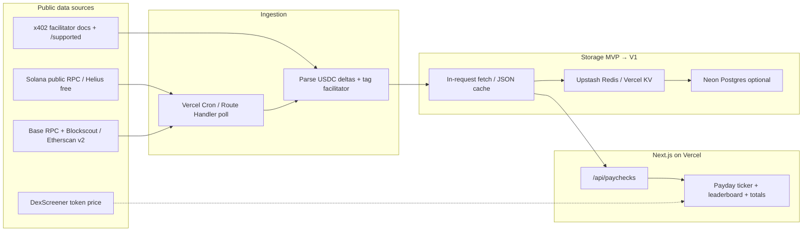
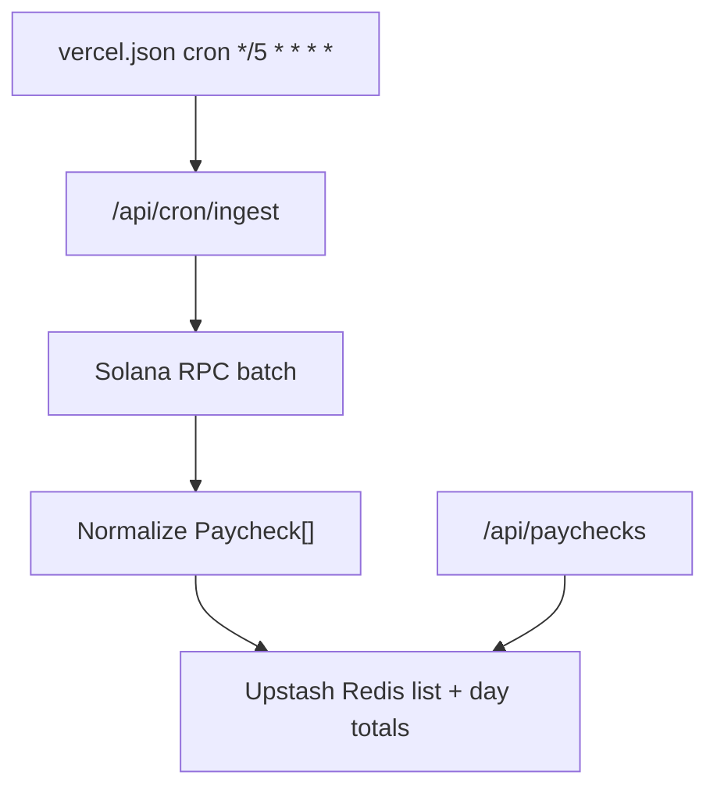
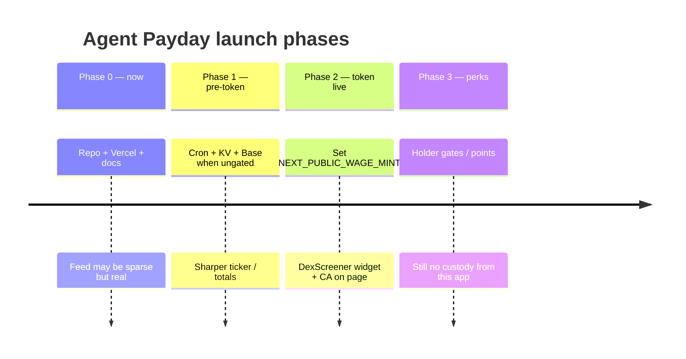

# $WAGE Agent Payday — Architecture & System Design

**Status:** MVP foundation (pre-token)  
**Audience:** bro (Manila, Asia/Manila UTC+8)  
**Hard rules:** real on-chain data only; **do not deploy** the token or touch wallets/funds from this repo.

---

## 1. What this is

**Agent Payday** is a small public web page whose meme hook is a live ticker of **real payments to / through AI-agent rails** — e.g. x402 facilitator settlements, agent wallet inflows, later ERC-8004 / agent-credit repayments (Priors, ClawBank, CLAUS-class agents).

The Solana memecoin **$WAGE** is the cultural wrapper. The product truth is the paycheck feed. If the feed cannot verify a row, it shows **empty**, never fake rows.



---

## 2. Goals for a ~2-day MVP

| Day | Ship |
| --- | --- |
| 0–1 | Landing + empty-safe feed + `/api/paychecks` reading **one** free public source |
| 1–2 | Curated facilitator list, explorer links on every row, total-paid-today, deploy on Vercel |
| Later | Token CA widget, Base ingestion, leaderboard, holder perks |

**Non-goals (MVP):** deploying $WAGE, custody, swapping, claiming rewards, writing to chain, paid API dependence.

---

## 3. Data sources (honest availability as of 2026-11-05)

| Source | Use | Free path | Caveat |
| --- | --- | --- | --- |
| **Solana RPC** (`api.mainnet-beta.solana.com`) | `getSignaturesForAddress` + `getTransaction` (jsonParsed) for USDC deltas | Yes | Strict rate limits; fine for MVP polling |
| **Helius free tier** | Same as above, higher limits | Needs API key | Prefer when bro adds a key |
| **Base public RPC** (`mainnet.base.org`, publicnode, 1rpc) | `eth_getLogs` on USDC `Transfer` | Partial | Range limits / 403 / request caps |
| **Blockscout Base API** | Address token transfers | **Gated** | Returns `402` “Proceed with API key or make a X402 payment” — ironic, not usable without key/payment |
| **Etherscan API v2** | Basescan tokentx | Needs paid plan for Base on free tier | Skip for MVP |
| **x402 facilitator registries** | Curated sender addresses (PayAI, Dexter, Daydreams, Coinbase, …) | Public GitHub /satohub | Addresses are **facilitators**, not “the agent” |
| **Priors facilitator** | `facilitator.priors.trade/supported` exposes signer on Robinhood Chain | Public | Different chain; phase 2 |
| **DexScreener** | `$WAGE` price widget after CA exists | Public | Show `—` until mint configured |

**MVP choice:** Solana public RPC + curated x402 facilitator wallets from public x402scan configs.  
**Base:** listed in code as `BASE_FACILITATORS_PENDING` until a non-gated indexer exists.

---

## 4. What counts as a “paycheck”

```mermaid
sequenceDiagram
  participant Agent as Agent / merchant wallet
  participant Fac as x402 facilitator
  participant Chain as Solana / Base
  participant API as /api/paychecks
  participant UI as Payday UI

  Note over Agent,Fac: User or protocol pays; facilitator settles USDC
  Fac->>Chain: USDC Transfer (facilitator → counterparty)
  API->>Chain: getSignaturesForAddress(facilitator)
  API->>Chain: getTransaction(sig) jsonParsed
  API->>API: Detect facilitator USDC decrease + other owner increase
  API->>UI: Paycheck row + explorer URL
  UI->>Chain: User verifies on Solscan / Basescan
```

**Included (MVP):** USDC leaving a **documented x402 facilitator** to another owner (settlement / payout proxy signal).  
**Not claimed:** that the `to` address is a verified “AI agent identity.” Label copy must say facilitator settlement, not “this wallet is GPT.”  
**Future:** ERC-8004 credit repayments, ClawBank/Priors-specific events, named agent directories once public registries stabilize.

---

## 5. Ingestion

### MVP (what ships now)

- On-demand fetch inside `GET /api/paychecks` and the landing page server component.
- No durable store; Cloudflare/Vercel edge cache headers (`s-maxage≈30`).
- Fail **open to empty**: any RPC error → `paychecks: []` + `emptyReason` / `errors`.

### Phase 1.5 (still ~1 day)



- Vercel Cron hits a protected ingest route (`CRON_SECRET`).
- Store last N paychecks + `totalPaidTodayUsd` in **Upstash Redis** (free) or a single JSON blob in Blob storage.
- Dedupe by `txHash + to`.

### Phase 2

- Neon Postgres for leaderboard aggregates, agent labels, multi-chain.
- Optional Helius webhooks / Yellowstone gRPC if volume justifies.

---

## 6. API surface

| Route | Method | Behavior |
| --- | --- | --- |
| `/api/paychecks` | GET | Real rows or empty list; never synthetic amounts |
| `/api/cron/ingest` | GET/POST | Phase 1.5; auth via secret |
| `/api/price` | GET | Phase post-CA; DexScreener by mint |

**Response shape (MVP):**

```json
{
  "ok": true,
  "generatedAt": "ISO-8601",
  "source": "solana-public-rpc + curated x402 facilitator wallets",
  "note": "...",
  "totalPaidTodayUsd": 0.12,
  "paychecks": [
    {
      "id": "sig:recipient",
      "chain": "solana",
      "txHash": "...",
      "explorerUrl": "https://solscan.io/tx/...",
      "timestamp": 1793880964,
      "from": "facilitator",
      "to": "recipient",
      "amount": 0.001,
      "symbol": "USDC",
      "facilitatorLabel": "PayAI x402 facilitator (Solana)"
    }
  ],
  "emptyReason": "optional",
  "errors": ["optional upstream notes"]
}
```

---

## 7. Frontend

- **Next.js App Router** on Vercel.
- Landing: title **Agent Payday**, badge that **token is not deployed**, stats (paid today / row count / `$WAGE` price placeholder).
- **Payday ticker:** live rows or explicit **“Live feed coming”** empty state.
- Later: leaderboard (top receiving addresses by 24h USDC), price widget via DexScreener.

Anti-fake UX rules:

1. Every row has `explorerUrl`.
2. No skeleton rows with made-up dollar amounts.
3. Copy distinguishes “facilitator settlement” from “verified agent identity.”

---

## 8. Anti-fake verification

| Control | Implementation |
| --- | --- |
| Explorer link | Required field on `Paycheck` |
| Curated senders only | `lib/agents.ts` with `sourceUrl` citations |
| No seed data in UI | Empty state component when `paychecks.length === 0` |
| Parse, don’t invent | Amounts from on-chain token balance deltas only |
| Transparent errors | `errors[]` surfaced in footer / API |

---

## 9. Launch phases



1. **MVP (pre-deploy):** this repo. Marketing can screenshot the live site.
2. **Token deploy (manual, out of band):** bro deploys on pump.fun himself; paste CA into env `NEXT_PUBLIC_WAGE_MINT`.
3. **Holder perks (later):** snapshot holders via DAS/Helius; optional points — never requires this app to hold keys.

---

## 10. Risks (honest)

| Risk | Why it matters | Mitigation |
| --- | --- | --- |
| **Facilitator ≠ agent** | Easy to overclaim in CT copy | Label settlements accurately |
| **Public RPC rate limits** | Empty feed during peaks | Cache; add Helius key |
| **Indexer paywalls** | Blockscout/Etherscan Base gated | Stick to Solana first; eth_getLogs carefully |
| **Micropayment noise** | Many $0.001 x402 fills | Threshold filter + aggregate “paid today” |
| **Address drift** | Facilitators rotate keys | Version `lib/agents.ts`; cite sources |
| **Memecoin regulatory / trust** | Fake utility backlash | Never fake data; open source parsers |
| **Ops footguns** | Accidental token deploy / wallet connect | No deploy scripts; no private keys in repo |
| **Attribution errors** | Wrong `to` on complex txs | Prefer simple USDC delta pairs; drop ambiguous txs |

---

## 11. Suggested 2-day build checklist

- [x] Next.js scaffold + landing empty-safe UI  
- [x] `/api/paychecks` Solana facilitator parser  
- [x] Architecture doc (this file)  
- [x] GitHub repo + Vercel project  
- [ ] Upstash + cron ingest  
- [ ] Base logs path or Blockscout key  
- [ ] Leaderboard UI  
- [ ] `$WAGE` CA + DexScreener widget after deploy  

---

## 12. Repo map

```
wage-agent-payday/
  app/
    page.tsx              # Agent Payday landing
    api/paychecks/route.ts
  lib/
    agents.ts             # Curated wallets + citations
    solana.ts             # Public RPC parser
    types.ts
  docs/ARCHITECTURE.md
  README.md
```
